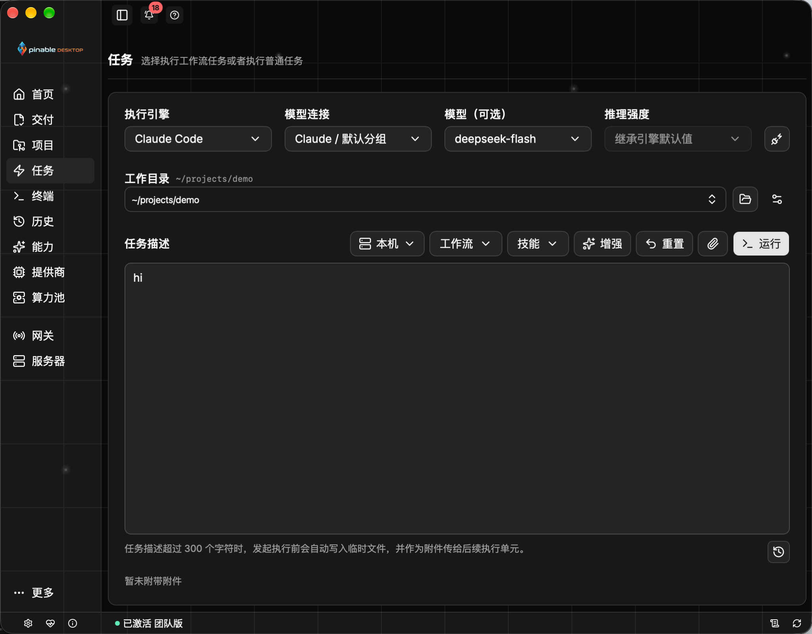

# PinableAgents

PinableAgents is an AI desktop workbench built with Wails. It brings AI runtime configuration, workflow orchestration, and local software delivery into one interface.

[Website](https://pinable.cc/) · [Downloads](https://pinable.cc/downloads) · [Releases](https://github.com/PinableAgents/pinable.cc/releases)

## Features

- Configure AI providers, models, and execution backends from one workspace.
- Orchestrate workflow tasks with parallel execution and isolated Git worktrees.
- Review execution history, delivery evidence, and approval timelines.

## Screenshot



## Downloads

Desktop packages for macOS and Windows are available from the [download page](https://pinable.cc/downloads) and [GitHub Releases](https://github.com/PinableAgents/pinable.cc/releases). Linux core runtime packages are also available from the release page.

## About this repository

This repository hosts the product website, public documentation, and downloadable release packages. The desktop application is closed source.

## Maintenance

To rewrite the repository into a single anonymous commit and clear GitHub-side history artifacts, run:

```bash
CONFIRM=YES ./scripts/wipe-github-history.sh
```

Optional environment variables:

```bash
REMOTE=origin
BRANCH=main
AUTHOR_NAME=Anonymous
AUTHOR_EMAIL=anonymous@invalid
COMMIT_MESSAGE="Initial commit"
```
